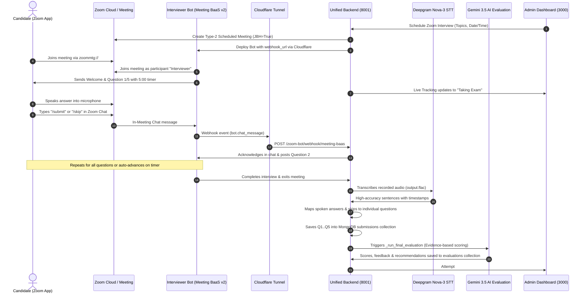

# 🚀 Eklakhya AI Interview Platform — System Architecture & Flow Guide

> **Single Source of Truth** for the Complete Technical Workflow, Unified Zoom Integration, Autonomous In-Meeting Bot, Real-time Proctoring, and Evaluation Pipelines.

---

## 📑 Table of Contents
1. [High-Level Architecture](#1-high-level-architecture)
2. [Component Overview](#2-component-overview)
3. [End-to-End Interview Workflows](#3-end-to-end-interview-workflows)
   - [Flow A: Native Zoom Bot Flow (100% In-Meeting Chat)](#flow-a-native-zoom-bot-flow-100-in-meeting-chat)
   - [Flow B: In-Client / Dual-Screen Portal Flow](#flow-b-in-client--dual-screen-portal-flow)
4. [Silence & Inactivity Detection Engine](#4-silence--inactivity-detection-engine)
5. [Admin Live Monitoring & Tracking](#5-admin-live-monitoring--tracking)
6. [AI Evaluation Pipeline (Multi-LLM Scoring)](#6-ai-evaluation-pipeline-multi-llm-scoring)
7. [Environment & Configuration Reference (`backend/.env`)](#7-environment--configuration-reference-backendenv)
8. [How to Run & Verify the System](#8-how-to-run--verify-the-system)

---

## 1. High-Level Architecture

```
                               ┌────────────────────────────────────────────────────────┐
                               │                    FRONTEND (IONIC/ANGULAR)            │
                               │                   Runs on http://localhost:3000        │
                               ├──────────────────────────┬─────────────────────────────┤
                               │ Admin Dashboard          │ Student Portal / Zoom App   │
                               │ • Live Exam Cards        │ • Dynamic Question UI       │
                               │ • 30fps Screen Mirroring │ • Skip / Clear / Submit     │
                               │ • Proctor Violation Logs │ • Multiple Face Detection   │
                               └─────────────┬────────────┴───────────────▲─────────────┘
                                             │ WebSocket / REST           │
                                             ▼                            │
┌─────────────────────────────────────────────────────────────────────────┴─────────────┐
│                                UNIFIED BACKEND (FASTAPI)                              │
│                              Runs on http://127.0.0.1:8001                            │
├───────────────────────────────────────────────────────────────────────────────────────┤
│ 1. Core Endpoints (/auth, /questions, /submissions, /admin, /student, /meetings)      │
│ 2. Zoom Bot Engine (/zoom-bot/*)                                                      │
│    • Recall.ai Client (or Mock double for offline testing)                           │
│    • Deepgram Streaming STT Integration (Multilingual: Hindi + English)               │
│    • State Machine: /start, /submit, /skip, /clear, /show                             │
│    • Per-question Countdown Timer & Smart Silence Detection                           │
│ 3. Proctoring & WebRTC Hub                                                            │
│    • WebSocket /ws/stream-screen/{username} (Screen Mirroring)                         │
│    • Multi-face violation logs                                                        │
│ 4. Autonomous Evaluation Engine                                                       │
│    • Evidence-based scoring (Gemini 2.5 / OpenAI / OpenRouter Fallback)               │
│    • Technical, Communication, and Final Verdict calculations                         │
└────────────────────────────┬─────────────────────────────┬────────────────────────────┘
                             │                             │
                             ▼                             ▼
              ┌─────────────────────────────┐  ┌────────────────────────────────────────┐
              │      MONGODB DATABASE       │  │        ZOOM CLOUD / RECALL BOT         │
              │  interview_platform (27017) │  │  • Candidate audio/video               │
              │  • users & timetables       │  │  • Autonomous meeting bot entry        │
              │  • questions & submissions  │  │  • In-Meeting Chat Question Delivery   │
              │  • evaluations & audit logs │  │                                        │
              └─────────────────────────────┘  └────────────────────────────────────────┘
```

---

## 2. Component Overview

| Component | Path | Responsibility |
|---|---|---|
| **Main FastAPI App** | [`backend/main.py`](file:///d:/code/Interview/backend/main.py) | Unified server running on port `8001`. Loads `.env`, preloads Silero VAD, registers all route modules. |
| **Zoom Bot Engine** | [`backend/code/zoom_bot/`](file:///d:/code/Interview/backend/code/zoom_bot/) | Unified autonomous in-meeting bot. Chat commands, per-question timers, silence prompt, Deepgram STT. |
| **Zoom Bot Service** | [`backend/code/services/zoom_bot_service.py`](file:///d:/code/Interview/backend/code/services/zoom_bot_service.py) | In-memory bridge between meeting scheduling, live tracking, and evaluation triggers. |
| **Evaluation Engine** | [`backend/code/evaluation/routes.py`](file:///d:/code/Interview/backend/code/evaluation/routes.py) | LLM-based multi-tier evaluation pipeline with evidence verification and JSON scoring. |
| **Admin Live Tracking** | [`backend/code/services/live_tracking.py`](file:///d:/code/Interview/backend/code/services/live_tracking.py) | Real-time memory storage of active exams, progress counters, and candidate status. |
| **Angular Frontend** | [`src/app/pages/admin/`](file:///d:/code/Interview/src/app/pages/admin/) & [`src/app/pages/student/`](file:///d:/code/Interview/src/app/pages/student/) | Ionic/Angular UI running on port `3000`. Full admin dashboard and candidate interface. |

---

## 3. End-to-End Interview Workflows

### Flow A: Native Zoom Bot Flow (100% In-Meeting Chat via Meeting BaaS & Deepgram)
> Student operates exclusively inside the Zoom application without opening external web portals.



#### Available Zoom Chat Commands:
* **`/start`** — Begins the interview session and loads Question 1.
* **`/submit`** — Saves current spoken answer, echoes confirmation, and advances to next question.
* **`/skip`** — Skips current question without answer and advances.
* **`/clear`** — Discards words spoken for the current question so candidate can answer cleanly.
* **`/show`** — Displays what has been transcribed so far for verification.
* **`/repeat`** — Re-posts the question text and remaining time in chat.
* **`/help`** — Lists all command syntax and shortcuts.

---

### Flow B: In-Client / Dual-Screen Portal Flow
> For candidates using the Portal with AI Video Proctoring and Screen Mirroring alongside Zoom.

1. **Auto-Launch & Hardware Pre-check:**
   - Candidate clicks **"Launch Zoom & Start Setup"**.
   - Zoom Meeting starts in desktop client with host bypass (Zero waiting room).
   - Candidate completes **Mic Check**, **AI Face Baseline Check** (`face-api.js`), and grants **Screen Share**.
2. **Active Exam Dashboard:**
   - Large Question display with 3-minute reverse countdown.
   - ⏩ `[ Skip Question ]`, 🗑️ `[ Clear Answer ]`, ➡️ `[ Submit & Next ]`.
   - Live Speech-to-Text displaying words as candidate speaks.
3. **AI Proctoring Safeguards:**
   - **Multiple Face Detection:** Runs on camera feed. If $\ge 2$ faces appear, banner triggers and violation logs to Admin.
   - **Screen Mirroring:** Streams full screen at 30fps to Admin WebSocket (`/ws/stream-screen/{username}`).

---

## 4. Silence & Inactivity Detection Engine

To prevent candidates from freezing or waiting indefinitely without assistance:
* **Threshold:** Configured via `SILENCE_TIMEOUT_SEC=35` in `backend/.env`.
* **Mechanism:**
  - Upon question dispatch, `last_speech_at` timestamp is initialized.
  - As transcripts arrive from Deepgram, `last_speech_at` updates continuously.
  - If no transcript arrives for 35 seconds while $>60$ seconds remain:
    ```text
    💡 Still thinking? You have 2:25 left. Speak your answer, or type /skip to move to the next question.
    ```
  - An event `silence_detected` is broadcast to Admin Live Tracking so proctors are informed in real-time.

---

## 5. Admin Live Monitoring & Tracking

Accessible at `http://localhost:3000/admin` under **Live Tracking**:

```
┌────────────────────────────────────────────────────────────────────────┐
│ 🔴 LIVE MONITORING DASHBOARD (Port 3000)                               │
├───────────────────────────────┬────────────────────────────────────────┤
│ Active Candidates: 1          │ Questions Answered: 3                  │
├───────────────────────────────┴────────────────────────────────────────┤
│ ┌────────────────────────────────────────────────────────────────────┐ │
│ │ 👤 Ankush Patel   [🟢 Taking Exam]                ⏱️ 02:45 / 05:00 │ │
│ │ Progress: [████████████░░░░░░░░] 3/5 Questions (60%)               │ │
│ │ Current Q: Explain OOP concepts in Python with examples...         │ │
│ │ Live Transcript: "Object oriented programming uses classes..."    │ │
│ │ [👁️ View Live Screen] [📹 Zoom Intercom] [📋 Proctor Logs]        │ │
│ └────────────────────────────────────────────────────────────────────┘ │
└────────────────────────────────────────────────────────────────────────┘
```

* **Live WebSocket Feed:** Connected to `/ws/admin/live-exams`.
* **Clickable Actions:**
  - **View Live Screen:** Opens modal displaying candidate's live screen mirroring.
  - **Proctor Logs:** Shows timestamped logs (tab switches, eye gazes, multiple faces, silence alerts).
  - **Zoom Live Intercom:** Two-way audio/video monitoring with student.

---

## 6. AI Evaluation Pipeline (Multi-LLM Scoring)

When an exam finishes:
1. Answers are saved into MongoDB `submissions` collection.
2. Background worker executes `_run_final_evaluation()`:
   - Primary LLM: **Google Gemini 2.5 Flash Lite** (`gemini-3.5-flash-lite`).
   - Secondary Fallback: **OpenAI GPT-4o / OpenRouter Nemotron**.
3. **Scoring Breakdown:**
   - **Technical Score (0–100):** Depth of technical concepts, correct keywords, accuracy.
   - **Communication Score (0–100):** Fluency, clarity, structure, professionalism.
   - **Confidence Score (0–100):** Tone, hesitation rate, speech cadence.
   - **Proctor Integrity Score (0–100):** Penalized by detected violations (-20 per suspicious event).
4. Saved permanently into `evaluations` collection and available in Admin Results tab.

---

## 7. Environment & Configuration Reference (`backend/.env`)

```ini
# Server & Database
MONGO_URL=mongodb://127.0.0.1:27017/
JWT_SECRET_KEY="<your-jwt-secret>"

# Zoom Credentials (Server-to-Server OAuth)
ZOOM_VIDEO_SDK_KEY="<video-sdk-key>"
ZOOM_VIDEO_SDK_SECRET="<video-sdk-secret>"

# Zoom Bot (Recall.ai) Configuration
RECALL_API_KEY=""                    # Leave empty for offline MOCK mode
RECALL_REGION="us-west-2"
PUBLIC_BASE_URL=""                   # ngrok HTTPS URL for live webhooks
WEBHOOK_TOKEN="dev-webhook-token"
BOT_NAME="Interviewer"
DEFAULT_TIME_LIMIT_SEC=300           # 5 minutes per question
WARN_BEFORE_SEC=60                   # Warning 1 minute before end
SILENCE_TIMEOUT_SEC=35               # Silence prompt after 35s
CHAT_MODE="everyone"
AUTO_LEAVE=true

# Speech Recognition (Deepgram)
DEEPGRAM_API_KEY="a4a339958932daab00174d7e50624ac925e49ea2"
DEEPGRAM_MODEL="nova-3"
DEEPGRAM_LANGUAGE="multi"            # Multilingual Hindi + English
DEEPGRAM_INTERIM=true

# AI LLM Models for Evaluation
GEMINI_API_KEY="<gemini-api-key>"
GEMINI_MODEL="gemini-3.5-flash-lite"
OPENAI_API_KEY="<openai-api-key>"
OPENROUTER_API_KEY="<openrouter-key>"
```

---

## 8. How to Run & Verify the System

### A. Start Unified Backend Server:
```powershell
# In PowerShell from project root:
backend\.venv\Scripts\python.exe -m uvicorn main:app --app-dir backend --port 8001 --reload
```
* Swagger Docs: `http://127.0.0.1:8001/docs`
* Bot Health Check: `http://127.0.0.1:8001/zoom-bot/api/health`

### B. Start Frontend Portal:
```powershell
npm run dev
# Or:
npx ng serve --host 0.0.0.0 --port 3000
```
* Admin Panel: `http://localhost:3000/admin`
* Student Portal: `http://localhost:3000/student`

### C. Run Bot End-to-End Test Suite:
```powershell
backend\.venv\Scripts\python.exe interview-zoom-bot\simulate.py
```
* Automatically executes 25 assertions verifying:
  - Welcome trigger, `/start` lock, live transcript buffering.
  - `/submit`, `/skip`, `/clear`, `/show` commands.
  - Per-question timers, warning prompts, and auto-submit.
  - Admin WebSocket fan-out and completion handoff.

