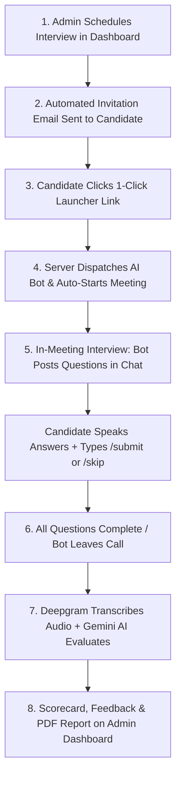

# 🚀 AI Interview Platform — Zoom, Google Meet & Microsoft Teams Integration Summary

## 📌 Executive Overview
The **AI Interview Platform** features an autonomous, bot-driven interview architecture supporting **Zoom**, **Google Meet**, and **Microsoft Teams**. Candidates can take their complete technical or behavioral assessment directly inside native Zoom, Google Meet, or Microsoft Teams without ever logging into an external student test portal.

Throughout the interview, an AI agent bot (**`Interviewer`**) joins the call in real time, posts questions sequentially in the in-meeting chat, listens to the candidate's spoken responses through the microphone, tracks timer and chat commands (`/submit`, `/skip`, `/repeat`, `/end`), and automatically hands off the final transcript to **Google Gemini AI** for rubric-based scoring and comprehensive performance reporting on the Admin Dashboard.

---

## 🌟 Key Capabilities & Highlights

1. **Zero External Portal Login:**
   - Candidates do not need to register, remember passwords, or navigate a web testing UI.
   - The entire interview is conducted 100% inside native **Zoom**, **Google Meet**, or **Microsoft Teams** on their mobile phone or PC.

2. **1-Click Frictionless Launcher (No Waiting Room):**
   - Traditional Zoom scheduled meetings often trap users on the *"Waiting for host to start this meeting"* screen.
   - The platform utilizes host authentication tokens (`ZAK`), allowing candidates to auto-start the meeting instantly with zero waiting room or manual host approvals.

3. **Interactive In-Meeting Chat Controller:**
   - The AI Bot posts questions one by one into the meeting chat interface.
   - The candidate speaks their answers into their microphone and controls interview flow using standard chat commands:
     - `/submit` — Submits current response and moves immediately to the next question.
     - `/skip` — Skips the current question.
     - `/repeat` — Re-displays the current question prompt in chat.
     - `/end` — Early wrap-up of the interview session.

4. **Smart Timer & Anti-Stuck Safeguards:**
   - Each question has a configurable time window (e.g., 5 minutes).
   - If a candidate finishes speaking but forgets to type `/submit`, the autonomous controller automatically records the answer and advances to the next question upon timer expiry.

5. **Deep Speech-to-Text & Gemini AI Evaluation:**
   - Post-call audio recordings are processed via **Deepgram Nova-3** for speech-to-text diarization.
   - **Google Gemini AI** evaluates each question response against expected technical key points, checks for contradictions, and outputs scores for **Technical Accuracy**, **Completeness**, and **Clarity**.

---

## 🔄 End-to-End Workflow

---

## 📋 Step-by-Step Breakdown

### Step 1: Scheduling (Admin Dashboard)
- The administrator navigates to the Admin Panel, selects the candidate, date, time slot, and subjects (e.g., Python, C, Data Structures & Algorithms).
- The platform automatically samples an exam question set (typically **10 questions**: 1 Introduction + categorized technical questions balanced across difficulty levels) and locks it in MongoDB.

### Step 2: Automated Email Dispatch
- A formatted invitation email is automatically delivered to the candidate's inbox containing:
  - Appointment window (Start and End time in IST).
  - Selected topics and preparation guidelines.
  - Primary button: **`🚀 1-Click Launch Zoom & Start Bot`**.

### Step 3: On-Demand Bot Deployment & Meeting Launch
- At the scheduled time, the candidate clicks the link from their phone or computer.
- The backend server performs two coordinated actions:
  1. Calls the **Meeting BaaS Cloud API** to deploy the **`Interviewer`** AI Bot into the scheduled room.
  2. Redirects the candidate directly into Zoom/Google Meet with pre-authenticated credentials, completely bypassing the waiting room.

### Step 4: Live In-Meeting Bot Interview
- The AI Bot enters the room and posts an initial welcome message in the in-meeting chat.
- **Question Flow:**
  - The bot posts Question 1 (Introduction) with time limit instructions.
  - The candidate speaks clearly into the microphone.
  - Once finished, the candidate sends `/submit` in the in-meeting chat.
  - The bot confirms with `✅ Question 1 answer recorded!` and immediately posts Question 2.
  - Commands like `/skip` and `/repeat` are available at any time.

### Step 5: Meeting Conclusion
- Upon completing all questions (or when the candidate sends `/end`):
  - The bot posts a congratulatory closing message:  
    `"🎉 All questions completed! The bot is disconnecting and your AI evaluation report is being generated."`
  - The bot cleanly disconnects from the call.

### Step 6: Audio Transcription & Gemini AI Evaluation
- The backend fetches the raw high-fidelity audio recording from the meeting.
- **Deepgram Nova-3** performs speech-to-text transcription with smart punctuation and sentence segmentation.
- **Google Gemini AI** scores each question response against:
  - Key technical concepts covered.
  - Conceptual contradictions or false statements.
  - Communication clarity and completeness.

### Step 7: Scorecard & Admin Results
- The Admin Dashboard receives real-time results:
  - Overall percentage score, grade, and status (Passed / Failed).
  - Per-question score breakdown, evidence quotes from spoken audio, and AI suggestions.
  - Downloadable/printable PDF Evaluation Report for institutional records.

---

## 🛠️ Architecture & Technology Stack

| Layer | Technology | Role |
|---|---|---|
| **Backend API** | FastAPI (Python 3.12), Uvicorn | Event-driven controller, routing, and database synchronization |
| **Bot Infrastructure** | Meeting BaaS v2 API | Live bot injection into Zoom, Google Meet & Microsoft Teams rooms |
| **Video Platforms** | Zoom REST API, Google Meet, Microsoft Teams | In-meeting video, audio streams, and live in-meeting chat |
| **Speech-to-Text (STT)**| Deepgram Nova-3 | High-accuracy speech diarization and sentence-level transcription |
| **Evaluation Engine** | Google Gemini AI (`gemini-3.5-flash-lite` / `gemini-1.5-pro`) | Rubric evaluation, conceptual grading, and actionable feedback |
| **Database** | MongoDB | Active meetings state, question bank, logs, and scorecards |
| **Tunnel / Webhooks** | Cloudflare Tunnel & Svix Webhooks | Sub-second real-time event delivery between meeting chat and backend |

---

## 🔒 Reliability & Security Measures
- **Anti-Burst / Debounce Locks:** Server-side `asyncio.Lock()` prevents rapid-fire duplicate chat submissions or packet replays from advancing multiple questions at once.
- **Per-Question Command Flush:** Each question flushes previous command buffers to guarantee zero carry-over between questions.
- **Network Resilience:** Transient network dropouts do not prematurely abort active interview sessions.
- **Strict Host Security:** One-click launch tokens are scoped strictly to the candidate's authorized schedule window.
